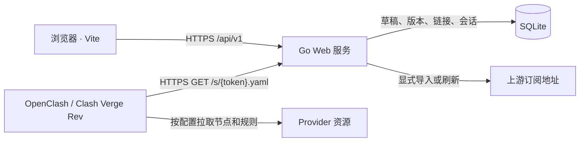

# Clash 配置台技术设计

状态：首期实现，待双客户端实机验收　｜　技术栈：Vite、Go、SQLite

## 1. 系统结构

生产环境由同一站点提供前端静态文件、账号 API 和客户端订阅接口。Go 服务负责权限、持久化、导入、校验、导出及发布。SQLite 保存配置草稿、只读版本及链接状态。路由器与桌面端直接读取已发布的 YAML。

- 前端采用 Vite、Vue 3、TypeScript，沿用原型的侧栏、工作区、YAML 预览和移动端标签。较长列表使用筛选和分页。表单与 YAML 预览共享字段路径用于错误定位。
- 后端使用 Go `net/http`、`database/sql`、`github.com/mattn/go-sqlite3` 和 `gopkg.in/yaml.v3`。配置编译、校验和上游获取位于 `internal/config`，账户、API 和 SQLite 位于 `internal/studio`。接口使用 JSON，导出和订阅直接返回 YAML。
- 初期单实例部署，SQLite 使用本地持久卷，启用迁移、外键、WAL 和 `busy_timeout`。请求读写使用短事务，可通过 SQLite 在线备份机制备份。上游读取在事务外完成。
- 反向代理终止 TLS，配置公开基址 `PUBLIC_BASE_URL` 生成订阅链接。确认路由器和桌面在代理尚未启动时也能解析并访问该域名。私有部署可使用两端均可访问的内网地址和受信任证书。
- `frontend/` 是连接 Go 服务的正式前端，`prototype/` 保留原型。项目启动与测试命令见 [README](../README.md)。

## 2. 配置建模与 YAML 编译

### 文档和编辑器

一份配置保存目标客户端、显示名称和完整 YAML 文档。用 YAML AST 处理导入及修改，便于保留键、注释、类型、被省略的字段和未知字段。编辑接口使用按模块定义的结构化请求，服务端用现有 AST 更新指定字段。列表编辑使用当次修订中的索引或唯一名称来定位，所有修改带对应草稿修订号。

| YAML 区段 | 文档结构与编辑约定 |
| --- | --- |
| 常规设置、`dns` | 布尔、数字、字符串、映射和列表分别处理。缺失、`null`、空列表、`false`、`0` 是独立状态。DNS 策略支持字符串或字符串列表，修改一个字段时保留同级项。 |
| `proxy-providers`、`rule-providers` | 以名称为键。变更时保留未编辑的字段，名称修改在同一事务中同步已识别的引用。Provider 路径按目标内核解析，提示同名缓存路径冲突。 |
| `proxies`、`proxy-groups` | 有序列表。保留出站字段序列和组成员顺序。表单根据协议显示字段，额外字段从原 YAML 保留。节点与组使用同一可引用名称空间。 |
| `rules`、`sub-rules` | 保持规则顺序。已知语法解析成类型、目标、内容及选项，逻辑规则使用支持括号嵌套的解析器，保留未知表达式原文，并给出内核检查提示。禁止用全局拆分逗号的办法编译复杂规则。 |
| 扩展 YAML | 结构化页面拥有已知顶层段，扩展编辑器拥有其余键，如 `tun`、`sniffer`、`hosts`、`profile`。保存时按顶层键更新，键冲突提示前往对应页面编辑。 |

上传时限制文件体积及可展开的 YAML 规模，拒绝重复映射键、多文档、自定义标签、递归别名和超出限制的嵌套。普通别名和合并键经受限解析后生成导出值。导出目标是语义稳定，未触及的注释和字段尽可能保留。对规范化导致的引号或缩进变化做差异说明。复杂未知字段可作为高级 YAML 编辑，目标内核的兼容结果需要单独记录。 [Mihomo 配置总览][mh] · [规则语法][rules]

### 原始订阅导入

1. 用户选择「导入完整 YAML」或「引用代理节点源」。服务器可发起一次受限探测，识别响应并显示不含凭据的摘要。允许设置针对上游的 User-Agent。
2. 完整 YAML 先进入导入预览，用户确认后新建配置。记录来源设定和上次成功摘要。主动刷新时以最近导入基线、上游新文档和现有草稿做三方比较，冲突项由用户选择；上游失败不修改草稿。
3. 远程节点源保留完整原地址、类型和下载参数，导出为 `proxy-providers`。在管理页只展示脱敏地址，最终 YAML 包含客户端拉取所需参数。目标设备需要能访问原地址。生成的订阅接口只读取已发布内容。
4. 限制重定向至允许的 HTTP(S) 地址，在每一跳检查解析与实际连接目标，拒绝本机、私网、链路本地、保留地址及含用户信息的 URL；禁止 DNS 重绑定绕过。导入服务设置连接超时、总超时、解压后体积限制和限速。规则集探测若加入，复用同一下载组件。

### 校验、导出、发布

流程为 `草稿修订 → YAML 结构校验 → 引用和业务校验 → 生成确定性的 YAML → 下载或事务发布`。

- 第一层校验结构、端口、必填字段、Provider 类型与格式组合、协议字段和规则类型。规则、组筛选和正则按目标 Mihomo 版本语义校验，避免只用 Go 标准正则误判。
- 第二层校验命名冲突、路由目标、`RULE-SET`、`use`、`dialer-proxy`、规则集和节点源的下载出口。对可静态分析的组成员、拨号链和下载依赖找环。出现条件性动态关系时给出警告。对于不可达规则返回具体位置，校验结果示例路径为 `rules[12]`。
- 第三层在 CI 或隔离联调环境中用固定版本的 `mihomo -t -d <隔离目录> -f <配置>` 验证 YAML。环境使用脱敏样例、本地 Provider 测试文件和固定 Geo 数据，避免核心在检查用户配置时拉取外部资源或访问宿主文件。生产服务初期以静态校验为主，界面单独展示有无运行时验证。
- 下载使用当前草稿的生成结果，返回 UTF-8 YAML。发布操作验证用户确认的草稿修订号，并在同一事务内插入不可变版本、更新已发布版本指针、记录时间。客户端总是读取已发布指针对应的完整 YAML。校验失败或并发冲突时保留上次发布。
- 恢复历史版本时将历史快照复制到草稿。预览后发布为新版本，已有链接继续跟随发布指针。

## 3. SQLite 模型

| 表 | 关键列和约束 |
| --- | --- |
| `users` | `id`，`username`，`username_normalized UNIQUE`，`password_hash`，`created_at`。 |
| `sessions` | `session_digest PK`，`user_id FK`，`expires_at`，`created_at`。登出删除会话，按过期索引定期清理。 |
| `profiles` | `id`，`owner_id FK`，`name`，`target`，`draft_yaml`，`draft_rev`，`published_version_id` 可空，`updated_at`。按 `owner_id, updated_at` 建索引，发布指针只可引用当前配置的版本。 |
| `profile_imports` | `profile_id FK`，`source_url`，`user_agent`，`base_yaml`，`last_fetched_at`，`content_sha256`。记录完整配置上游导入基线。 |
| `profile_versions` | `id`，`profile_id FK`，`version`，`draft_rev`，`yaml`，`content_sha256`，`created_at`，以及 `UNIQUE(profile_id, version)` 和 `UNIQUE(profile_id, draft_rev)`。 |
| `subscription_links` | `id`，`profile_id FK`，`label`，`token_digest UNIQUE`，`token`，`created_at`，`revoked_at` 可空。多个设备可分别持有链接。 |
| `import_stages` | `id`，`owner_id FK`，可选 `profile_id FK`，导入内容、基线摘要、草稿修订号及过期时间。临时保存待确认的导入或更新。 |

按账户和配置 ID 做每一次变更与读取的授权。草稿使用乐观锁 `UPDATE … WHERE id=? AND owner_id=? AND draft_rev=?`，不匹配返回冲突。重试已发布的草稿修订时返回已有版本，保留当前发布指针。首次尝试发布已经被编辑更新的草稿修订时返回版本冲突。删除配置在一个事务内移除导入基线、版本和链接，先清空发布指针以满足外键约束。

保留文档整体加密，避免遗漏藏在高级 YAML 中的凭据。含敏感信息的列使用应用层 AEAD 加密，存储密钥版本和 nonce，密钥由部署环境注入。订阅 Token 使用 32 字节随机数，经 Base64URL 编码。数据库以 digest 查找，并通过加密列支持登录后重复制链接；默认列表遮盖 Token。应用日志仅记录链接 ID 或请求 ID，不记录原始 URL、Token、密码、YAML 正文。反向代理为外部订阅路径配置脱敏日志。备份需同时有受限访问的密钥备份，以便恢复。

## 4. HTTP 接口

会话接口通过 HttpOnly、Secure、SameSite Cookie 维持登录状态。密码使用 Argon2id，登录和注册限速，登出后销毁会话。写操作检查同源与 CSRF 令牌。所列 JSON API 版本前缀为 `/api/v1`。

| 方法与路径 | 行为 |
| --- | --- |
| `POST /auth/register`、`POST /auth/login`、`POST /auth/logout`、`GET /auth/me` | 注册、登录、登出、读取当前会话。 |
| `GET /profiles`、`POST /profiles` | 分页读取自己的配置，新建配置。可附带已校验的 YAML 或确认导入 ID。 |
| `GET /profiles/{id}`、`PATCH /profiles/{id}`、`DELETE /profiles/{id}` | 读取带 `draftRev` 的配置摘要、修改名称等元数据、删除配置。 |
| `POST /profiles/{id}/duplicate` | 复制草稿为新配置。 |
| `GET /profiles/{id}/draft`、`PATCH /profiles/{id}/draft` | 读取草稿与模块配置、以 `expectedDraftRev` 提交模块变更，返回新修订。 |
| `POST /imports/probe`、`POST /profiles/{id}/imports/refresh` | 按文件或原始 URL 生成短期导入预览，或比较上游变化。导入确认后才写草稿。 |
| `GET /profiles/{id}/preview`、`GET /profiles/{id}/export.yaml` | 预览指定草稿修订与校验结果，或下载该修订的 YAML。导出返回安全的附件文件名。 |
| `POST /profiles/{id}/publish`、`GET /profiles/{id}/versions` | 发布指定修订，获取版本列表。 |
| `POST /profiles/{id}/versions/{version}/restore` | 指定当前草稿修订，将历史版本恢复至新草稿。 |
| `GET /profiles/{id}/links`、`POST /profiles/{id}/links`、`GET /profiles/{id}/links/{link}/url`、`DELETE /profiles/{id}/links/{link}` | 管理链接、按需查看完整链接、吊销。已发布版本可创建链接，一个链接可对应一台设备。 |
| `GET /s/{token}.yaml`、`HEAD /s/{token}.yaml` | 对 OpenClash 和 Clash Verge Rev 返回同一份已发布 YAML。Token 即该链接的读取权限，客户端无需交互式登录。 |

订阅成功返回 `200 OK`、`Content-Type: application/yaml; charset=utf-8`、基于快照摘要的 `ETag`、`Cache-Control: private, no-store`，验证权限后可对匹配的 `If-None-Match` 返回 `304`。缺失、已吊销、未发布的资源统一返回 `404`，无需登录跳转。链接停用后，后续请求无法获得新内容，客户端保存过的版本可能仍在本地。订阅接口对一条链接的读取保持原子性，详见发布事务。内部 JSON 错误含 `code`、`message`、可选 `issues[{severity, path, message}]` 和 `requestId`。草稿冲突使用 `409`，非法配置使用 `422`，限速使用 `429`。

## 5. 开发顺序与联调

1. **配置闭环**。落地样例字段 schema、导入、AST 更新、静态校验和导出。用脱敏样例做语义往返、引用依赖和顺序验收，覆盖 73 个组和 59 个规则集。
2. **持久化与账号**。实现 SQLite 迁移、注册、登录、登出、多配置隔离及并发编辑保护。验证重启后草稿和发布数据可恢复。
3. **发布与客户端联调**。实现快照、链接生成、撤销及 YAML 响应。分别在用户实际使用的 OpenClash、Clash Verge Rev 版本及对应 Mihomo 内核验证下载、订阅、再次发布、刷新和 provider 更新。用文件和 URL 两条路径各测一次，在客户端覆写开关两种状态下检查运行配置。
4. **部署验收**。确认 TLS、客户端路径可达、数据库与密钥可备份恢复。测试失效订阅地址、非 YAML 响应、无权限访问、并发发布和链接吊销。

本机检测到 Clash Verge Rev 2.5.10，随包 Mihomo v1.19.33。以原型生成的 YAML 为基础，将远程 Provider 换成内联测试数据、剔除需要外部 Geo 数据的测试规则后，离线语法检查通过。目标 OpenClash 插件与内核版本待实机确认，双客户端加载及联调属于后续验收。 [OpenClash 订阅与管理][oc] · [Clash Verge Rev 订阅导入][cv]

[mh]: https://wiki.metacubex.one/config/
[rules]: https://wiki.metacubex.one/config/rules/
[oc]: https://github.com/vernesong/OpenClash/blob/dev/.github/skills/openclash-user-guide/12-subscribe-config.md
[cv]: https://www.clashverge.dev/guide/profile.html
